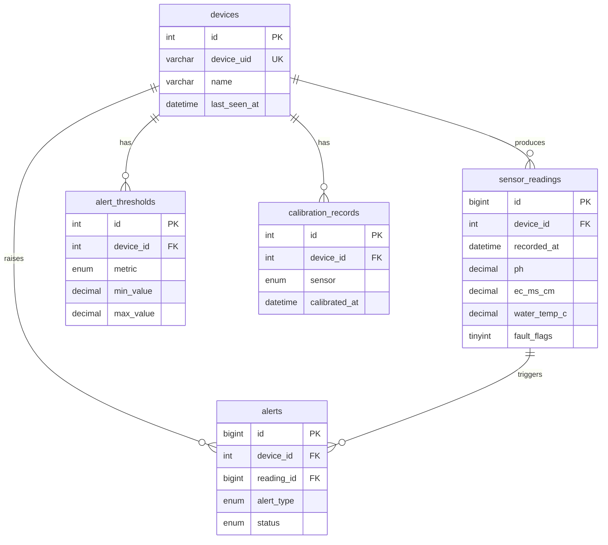

# Hydroponics Telemetry – Data Schema

Data contract and database schema for the **Automated Real-Time Hydroponics Telemetry and Alerting System** (ESP32 → MQTT → Go backend → MySQL → React dashboard).

This document covers:

1. [Data flow](#1-data-flow)
2. [MQTT contract](#2-mqtt-contract-esp32--backend) (topics and JSON payload sent by the ESP32)
3. [Validation rules](#3-validation-rules)
4. [Database schema](#4-database-schema-mysql-80) (MySQL 8.0)
5. [Indexing and performance](#5-indexing-and-performance)
6. [Example queries](#6-example-queries)
7. [Retention and sizing](#7-retention-and-sizing)

---

## 1. Data flow

```
Sensors ──► ESP32 ──(JSON, MQTT, every 60 s)──► Mosquitto ──► Go service ──► MySQL ──► REST API ──► React
                                                                  │
                                                                  └──► Alert engine ──► Email / Telegram
```

| Sensor | Interface | Measurement stored |
|---|---|---|
| DFRobot Analog pH Kit V2 (via ADS1115) | I2C (ADC) | `ph` |
| DFRobot Analog EC Kit V2, K=1.0 (via ADS1115) | I2C (ADC) | `ec_ms_cm` |
| DS18B20 | 1-Wire | `water_temp_c` (also used for pH/EC temperature compensation) |
| BME280 | I2C | `air_temp_c`, `humidity_pct`, `pressure_hpa` |

---

## 2. MQTT contract (ESP32 → backend)

### Topics

| Topic | Direction | QoS | Retained | Purpose |
|---|---|---|---|---|
| `hydroponics/{device_id}/telemetry` | ESP32 → broker | 1 | No | One sensor reading every 60 s |
| `hydroponics/{device_id}/status` | ESP32 → broker | 1 | Yes | `online` on connect; `offline` is set as the MQTT Last Will and Testament (LWT) |

The Go service subscribes to `hydroponics/+/telemetry` and `hydroponics/+/status`.

### Telemetry payload

```json
{
  "device_id": "esp32-hydro-01",
  "ts": 1792480800,
  "fw": "1.0.0",
  "ph": 6.12,
  "ec": 1.84,
  "water_temp": 22.5,
  "air_temp": 26.1,
  "humidity": 58.4,
  "pressure": 1008.2,
  "ph_mv": 1845.3,
  "ec_mv": 1210.7,
  "fault_flags": 0
}
```

### Field reference

| JSON field | Type | Unit | Required | Nullable | Description |
|---|---|---|---|---|---|
| `device_id` | string (≤ 64) | – | Yes | No | Unique device identifier; must match the topic |
| `ts` | integer | Unix seconds, UTC | Yes | No | Measurement time (from NTP). If the device has no valid time, the backend uses its own receive time |
| `fw` | string (≤ 20) | – | No | Yes | Firmware version |
| `ph` | number | pH | Yes | **Yes** | Temperature-compensated, calibrated pH |
| `ec` | number | mS/cm | Yes | **Yes** | Temperature-compensated (25 °C reference), calibrated EC |
| `water_temp` | number | °C | Yes | **Yes** | DS18B20 water temperature |
| `air_temp` | number | °C | Yes | **Yes** | BME280 ambient temperature |
| `humidity` | number | % RH | Yes | **Yes** | BME280 relative humidity |
| `pressure` | number | hPa | Yes | **Yes** | BME280 barometric pressure |
| `ph_mv` | number | mV | No | Yes | Raw ADS1115 voltage for the pH channel (calibration and debugging) |
| `ec_mv` | number | mV | No | Yes | Raw ADS1115 voltage for the EC channel (calibration and debugging) |
| `fault_flags` | integer (0–15) | bitmask | Yes | No | Which sensors failed this cycle (see below) |

**A failed sensor sends `null` for its value and sets its fault bit.** It must never send a placeholder such as `-127` (DS18B20 disconnected) or `85.0` (DS18B20 power-on reset value).

### `fault_flags` bitmask

| Bit | Value | Sensor |
|---|---|---|
| 0 | 1 | pH channel (ADS1115 read failed or out of range) |
| 1 | 2 | EC channel (ADS1115 read failed or out of range) |
| 2 | 4 | DS18B20 water temperature |
| 3 | 8 | BME280 |

Example: `fault_flags = 5` means pH and water temperature failed.

---

## 3. Validation rules

Applied by the Go service before insert. A payload that fails structural checks is rejected and logged. A payload with out-of-range values has those values stored as `NULL` and the matching fault bit set.

| Field | Rule |
|---|---|
| `device_id` | Non-empty, ≤ 64 chars, matches `[A-Za-z0-9_-]+`, equals the topic's `{device_id}` |
| `ts` | Integer; not more than 5 min in the future; not older than 24 h (otherwise fall back to receive time) |
| `ph` | 0 – 14 |
| `ec` | 0 – 20 mS/cm (probe range limit) |
| `water_temp` | −55 – 125 °C (DS18B20 limit); values `-127` and `85.0` are treated as faults |
| `air_temp` | −40 – 85 °C (BME280 limit) |
| `humidity` | 0 – 100 % |
| `pressure` | 300 – 1100 hPa |
| `fault_flags` | Integer 0 – 15 |

> Alert thresholds (section 4.4) are separate from validation. Validation decides if a value is *physically possible*; thresholds decide if it is *biologically unsafe*.

---

## 4. Database schema (MySQL 8.0)

All timestamps are stored in **UTC** as `DATETIME(3)` (millisecond precision, no 2038 limit). Engine is InnoDB, charset `utf8mb4`.



### 4.1 `devices`

One row per ESP32. Created manually or auto-registered on first message.

```sql
CREATE TABLE devices (
    id               INT UNSIGNED  NOT NULL AUTO_INCREMENT,
    device_uid       VARCHAR(64)   NOT NULL,                 -- matches "device_id" in the MQTT payload
    name             VARCHAR(100)  NOT NULL,
    location         VARCHAR(150)  NULL,
    firmware_version VARCHAR(20)   NULL,
    is_active        BOOLEAN       NOT NULL DEFAULT TRUE,
    is_online        BOOLEAN       NOT NULL DEFAULT FALSE,   -- driven by the MQTT status topic / LWT
    last_seen_at     DATETIME(3)   NULL,                     -- updated on every accepted telemetry message
    created_at       DATETIME(3)   NOT NULL DEFAULT CURRENT_TIMESTAMP(3),
    updated_at       DATETIME(3)   NOT NULL DEFAULT CURRENT_TIMESTAMP(3) ON UPDATE CURRENT_TIMESTAMP(3),
    PRIMARY KEY (id),
    UNIQUE KEY uq_devices_uid (device_uid)
) ENGINE=InnoDB DEFAULT CHARSET=utf8mb4;
```

### 4.2 `sensor_readings`

The main time-series table. One row per telemetry message.

```sql
CREATE TABLE sensor_readings (
    id             BIGINT UNSIGNED  NOT NULL AUTO_INCREMENT,
    device_id      INT UNSIGNED     NOT NULL,
    recorded_at    DATETIME(3)      NOT NULL,                -- from payload "ts" (UTC)
    received_at    DATETIME(3)      NOT NULL DEFAULT CURRENT_TIMESTAMP(3),

    ph             DECIMAL(4,2)     NULL,                    -- pH
    ec_ms_cm       DECIMAL(6,3)     NULL,                    -- mS/cm
    water_temp_c   DECIMAL(5,2)     NULL,                    -- °C
    air_temp_c     DECIMAL(5,2)     NULL,                    -- °C
    humidity_pct   DECIMAL(5,2)     NULL,                    -- % RH
    pressure_hpa   DECIMAL(7,2)     NULL,                    -- hPa

    ph_voltage_mv  DECIMAL(7,2)     NULL,                    -- raw ADS1115 value, for calibration review
    ec_voltage_mv  DECIMAL(7,2)     NULL,

    fault_flags    TINYINT UNSIGNED NOT NULL DEFAULT 0,      -- bitmask, see section 2

    PRIMARY KEY (id),
    UNIQUE KEY uq_readings_device_time (device_id, recorded_at),
    CONSTRAINT fk_readings_device
        FOREIGN KEY (device_id) REFERENCES devices (id) ON DELETE CASCADE,

    CONSTRAINT chk_ph       CHECK (ph           IS NULL OR ph           BETWEEN 0    AND 14),
    CONSTRAINT chk_ec       CHECK (ec_ms_cm     IS NULL OR ec_ms_cm     BETWEEN 0    AND 20),
    CONSTRAINT chk_wtemp    CHECK (water_temp_c IS NULL OR water_temp_c BETWEEN -55  AND 125),
    CONSTRAINT chk_atemp    CHECK (air_temp_c   IS NULL OR air_temp_c   BETWEEN -40  AND 85),
    CONSTRAINT chk_hum      CHECK (humidity_pct IS NULL OR humidity_pct BETWEEN 0    AND 100),
    CONSTRAINT chk_press    CHECK (pressure_hpa IS NULL OR pressure_hpa BETWEEN 300  AND 1100),
    CONSTRAINT chk_faults   CHECK (fault_flags BETWEEN 0 AND 15)
) ENGINE=InnoDB DEFAULT CHARSET=utf8mb4;
```

| Column | Type | Null | Notes |
|---|---|---|---|
| `id` | BIGINT UNSIGNED | No | Surrogate key |
| `device_id` | INT UNSIGNED | No | FK → `devices.id` |
| `recorded_at` | DATETIME(3) | No | Measurement time (UTC) |
| `received_at` | DATETIME(3) | No | Backend insert time; `received_at - recorded_at` gives pipeline latency |
| `ph` | DECIMAL(4,2) | Yes | `NULL` when the sensor faulted |
| `ec_ms_cm` | DECIMAL(6,3) | Yes | `NULL` when the sensor faulted |
| `water_temp_c` | DECIMAL(5,2) | Yes | `NULL` when the sensor faulted |
| `air_temp_c` | DECIMAL(5,2) | Yes | `NULL` when the sensor faulted |
| `humidity_pct` | DECIMAL(5,2) | Yes | `NULL` when the sensor faulted |
| `pressure_hpa` | DECIMAL(7,2) | Yes | `NULL` when the sensor faulted |
| `ph_voltage_mv` / `ec_voltage_mv` | DECIMAL(7,2) | Yes | Raw voltages; useful for re-deriving calibration and for the report |
| `fault_flags` | TINYINT UNSIGNED | No | `0` means all sensors healthy |

**Duplicate protection.** MQTT QoS 1 can deliver a message more than once. The unique key `(device_id, recorded_at)` makes duplicate inserts harmless:

```sql
INSERT INTO sensor_readings (device_id, recorded_at, ph, ec_ms_cm, water_temp_c,
                             air_temp_c, humidity_pct, pressure_hpa,
                             ph_voltage_mv, ec_voltage_mv, fault_flags)
VALUES (?, ?, ?, ?, ?, ?, ?, ?, ?, ?, ?)
ON DUPLICATE KEY UPDATE id = id;   -- silently ignore the duplicate
```

### 4.3 `calibration_records`

History of every probe calibration. Lets you trace which calibration produced which readings and supports the accuracy section of the report.

```sql
CREATE TABLE calibration_records (
    id              INT UNSIGNED  NOT NULL AUTO_INCREMENT,
    device_id       INT UNSIGNED  NOT NULL,
    sensor          ENUM('ph','ec') NOT NULL,
    calibrated_at   DATETIME(3)   NOT NULL,
    buffer_1_value  DECIMAL(6,3)  NOT NULL,   -- e.g. pH 4.00  | EC 1.413 mS/cm
    buffer_1_mv     DECIMAL(7,2)  NOT NULL,
    buffer_2_value  DECIMAL(6,3)  NOT NULL,   -- e.g. pH 7.00  | EC 12.88 mS/cm
    buffer_2_mv     DECIMAL(7,2)  NOT NULL,
    slope           DECIMAL(10,5) NULL,       -- derived
    intercept       DECIMAL(10,5) NULL,       -- derived
    temperature_c   DECIMAL(5,2)  NULL,       -- solution temperature during calibration
    is_active       BOOLEAN       NOT NULL DEFAULT TRUE,
    notes           VARCHAR(255)  NULL,
    PRIMARY KEY (id),
    KEY idx_calibration_device_sensor (device_id, sensor, calibrated_at),
    CONSTRAINT fk_calibration_device
        FOREIGN KEY (device_id) REFERENCES devices (id) ON DELETE CASCADE
) ENGINE=InnoDB DEFAULT CHARSET=utf8mb4;
```

### 4.4 `alert_thresholds`

Safe ranges per device and metric. The alert engine compares each accepted reading against these.

```sql
CREATE TABLE alert_thresholds (
    id               INT UNSIGNED  NOT NULL AUTO_INCREMENT,
    device_id        INT UNSIGNED  NOT NULL,
    metric           ENUM('ph','ec','water_temp','air_temp','humidity','pressure') NOT NULL,
    min_value        DECIMAL(8,3)  NULL,     -- NULL = no lower limit
    max_value        DECIMAL(8,3)  NULL,     -- NULL = no upper limit
    severity         ENUM('warning','critical') NOT NULL DEFAULT 'warning',
    cooldown_minutes SMALLINT UNSIGNED NOT NULL DEFAULT 30,   -- minimum gap between repeat notifications
    is_enabled       BOOLEAN       NOT NULL DEFAULT TRUE,
    created_at       DATETIME(3)   NOT NULL DEFAULT CURRENT_TIMESTAMP(3),
    updated_at       DATETIME(3)   NOT NULL DEFAULT CURRENT_TIMESTAMP(3) ON UPDATE CURRENT_TIMESTAMP(3),
    PRIMARY KEY (id),
    UNIQUE KEY uq_threshold (device_id, metric, severity),
    CONSTRAINT fk_threshold_device
        FOREIGN KEY (device_id) REFERENCES devices (id) ON DELETE CASCADE,
    CONSTRAINT chk_threshold_order
        CHECK (min_value IS NULL OR max_value IS NULL OR min_value < max_value)
) ENGINE=InnoDB DEFAULT CHARSET=utf8mb4;
```

Example starting values (**crop-dependent; adjust to the plant you grow**):

| metric | min | max | severity |
|---|---|---|---|
| ph | 5.5 | 6.5 | warning |
| ph | 5.0 | 7.0 | critical |
| ec | 1.2 | 2.5 | warning |
| water_temp | 18 | 24 | warning |

### 4.5 `alerts`

Every alert event, including its notification outcome.

```sql
CREATE TABLE alerts (
    id                   BIGINT UNSIGNED NOT NULL AUTO_INCREMENT,
    device_id            INT UNSIGNED    NOT NULL,
    reading_id           BIGINT UNSIGNED NULL,           -- reading that triggered it (NULL for device_offline)
    alert_type           ENUM('threshold_low','threshold_high','sensor_fault','device_offline') NOT NULL,
    metric               VARCHAR(20)     NULL,           -- NULL for device_offline
    observed_value       DECIMAL(10,3)   NULL,
    threshold_value      DECIMAL(10,3)   NULL,
    severity             ENUM('warning','critical') NOT NULL DEFAULT 'warning',
    status               ENUM('open','resolved') NOT NULL DEFAULT 'open',
    triggered_at         DATETIME(3)     NOT NULL,
    resolved_at          DATETIME(3)     NULL,
    notification_channel ENUM('email','telegram') NULL,
    notification_status  ENUM('pending','sent','failed') NOT NULL DEFAULT 'pending',
    notified_at          DATETIME(3)     NULL,
    notification_error   VARCHAR(255)    NULL,
    PRIMARY KEY (id),
    KEY idx_alerts_device_status (device_id, status, triggered_at),
    KEY idx_alerts_triggered (triggered_at),
    CONSTRAINT fk_alerts_device
        FOREIGN KEY (device_id)  REFERENCES devices (id)          ON DELETE CASCADE,
    CONSTRAINT fk_alerts_reading
        FOREIGN KEY (reading_id) REFERENCES sensor_readings (id)  ON DELETE SET NULL
) ENGINE=InnoDB DEFAULT CHARSET=utf8mb4;
```

`triggered_at` minus the reading's `recorded_at` gives detection latency, and `notified_at` minus `triggered_at` gives notification latency. Both are useful numbers for the validation chapter.

---

## 5. Indexing and performance

| Index | Table | Serves |
|---|---|---|
| `uq_readings_device_time (device_id, recorded_at)` | `sensor_readings` | Time-range charts, latest reading, keyset pagination, and duplicate protection (one index for all four) |
| `uq_devices_uid (device_uid)` | `devices` | Lookup by the ID in the MQTT topic |
| `idx_alerts_device_status (device_id, status, triggered_at)` | `alerts` | "Open alerts for device" on the dashboard |
| `uq_threshold (device_id, metric, severity)` | `alert_thresholds` | Threshold lookup during alert evaluation |

Guidelines:

- Always filter `sensor_readings` by `device_id` **and** a `recorded_at` range so the index is used.
- Paginate with **keyset pagination** (`WHERE recorded_at < ?`) rather than large `OFFSET` values.
- For wide time windows (weeks or months), aggregate in SQL (`AVG` per hour or day) instead of returning every 60-second row to the browser.

---

## 6. Example queries

**Latest reading for a device**

```sql
SELECT r.*
FROM sensor_readings r
JOIN devices d ON d.id = r.device_id
WHERE d.device_uid = 'esp32-hydro-01'
ORDER BY r.recorded_at DESC
LIMIT 1;
```

**Historical range with keyset pagination (REST `GET /readings`)**

```sql
SELECT id, recorded_at, ph, ec_ms_cm, water_temp_c, air_temp_c, humidity_pct, pressure_hpa, fault_flags
FROM sensor_readings
WHERE device_id = ?
  AND recorded_at BETWEEN ? AND ?
  AND recorded_at < ?            -- cursor: recorded_at of the last row of the previous page
ORDER BY recorded_at DESC
LIMIT 100;
```

**Hourly averages for a chart**

```sql
SELECT DATE_FORMAT(recorded_at, '%Y-%m-%d %H:00:00') AS hour_utc,
       ROUND(AVG(ph), 2)           AS avg_ph,
       ROUND(AVG(ec_ms_cm), 3)     AS avg_ec,
       ROUND(AVG(water_temp_c), 2) AS avg_water_temp
FROM sensor_readings
WHERE device_id = ?
  AND recorded_at >= UTC_TIMESTAMP() - INTERVAL 7 DAY
GROUP BY hour_utc
ORDER BY hour_utc;
```

**Devices that have gone silent (staleness alert)**

```sql
SELECT id, device_uid, last_seen_at
FROM devices
WHERE is_active = TRUE
  AND (last_seen_at IS NULL OR last_seen_at < UTC_TIMESTAMP(3) - INTERVAL 3 MINUTE);
```

**Open alerts**

```sql
SELECT a.id, d.device_uid, a.alert_type, a.metric, a.observed_value, a.threshold_value, a.triggered_at
FROM alerts a
JOIN devices d ON d.id = a.device_id
WHERE a.status = 'open'
ORDER BY a.triggered_at DESC;
```

---

## 7. Retention and sizing

At one reading every 60 s a device produces:

- 1,440 rows per day
- about 525,600 rows per year

At roughly 100–150 bytes per row including indexes, that is well under 100 MB per device-year, so no partitioning is needed for this project. For longer deployments, consider monthly partitioning on `recorded_at` or an hourly roll-up table, and optionally delete the raw `ph_voltage_mv` / `ec_voltage_mv` columns' data after the calibration review.
